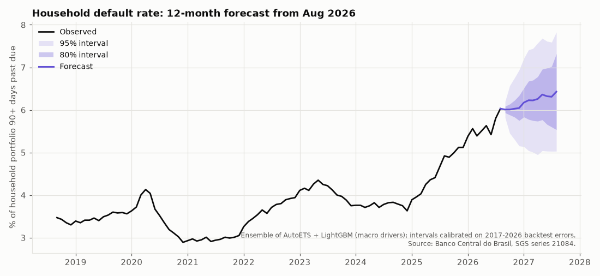
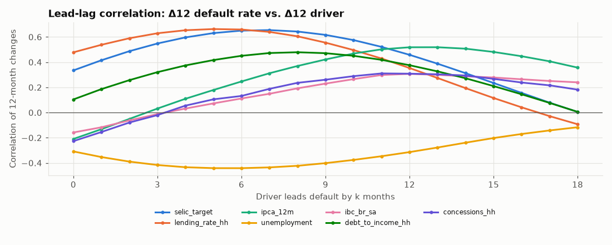
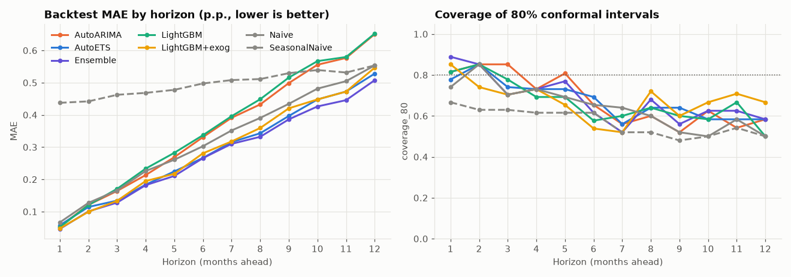
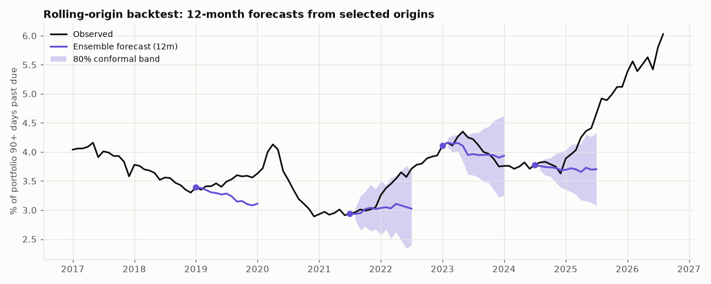

# Household Credit Default Forecasting with Banco Central do Brasil Data

Forecasts Brazil's household credit default rate 1-12 months ahead, with calibrated uncertainty bands. The
models use public macro data from the Banco Central do Brasil (BCB) SGS API and are tested with an honest
rolling-origin backtest.



## 1. Business problem

A bank's credit and treasury teams set **loan-loss provisions, pricing and capital buffers** months ahead of time.
For that they need to know where household delinquency is heading over the next 6-12 months, and **how far it
could plausibly go**. A single number is not enough: a 0.5 p.p. move in the 90+ day default rate on a BRL 10 bn
household book means BRL 50 mn more in non-performing balance.

This project answers three questions:
1. Which forecasting approach beats the simple "no change" assumption, and by how much, at each horizon?
2. Do macro drivers (Selic, inflation, lending rates, unemployment, activity, indebtedness) add predictive value?
3. Can the uncertainty bands be trusted? How often does reality fall inside them?

## 2. Data

All series come from the [BCB SGS API](https://dadosabertos.bcb.gov.br/), public data published on the BCB
open-data portal (see the portal's terms of use; cite the BCB as source). `scripts/download_data.py` downloads every series, caches the raw JSON in `data/raw/` (~0.5 MB) and
builds a monthly panel: **186 months, Mar 2011 - Aug 2026**. Every code below was checked by fetching it and
matching its name in the BCB open-data catalogue.

| SGS code | Column | Series | Frequency | Role |
|---:|---|---|---|---|
| 21084 | `default_rate_hh` | Credit portfolio default rate (90+ days), households, total (%) | monthly | **target** |
| 21112 | `default_rate_hh_free` | Default rate, non-earmarked credit, households (%) | monthly | EDA only |
| 432 | `selic_target` | Selic target rate set by Copom (% p.a.), averaged per month | daily | driver |
| 433 | `ipca_mom` → `ipca_12m` | IPCA monthly change → accumulated 12 months (%) | monthly | driver |
| 20716 | `lending_rate_hh` | Average interest rate on credit, households, total (% p.a.) | monthly | driver |
| 20633 | `concessions_hh` | Credit concessions (new loans), households, total (BRL mn) | monthly | driver |
| 24369 | `unemployment` | Unemployment rate, PNAD Contínua (%) | monthly | driver |
| 24364 | `ibc_br_sa` | IBC-Br economic activity index, seasonally adjusted | monthly | driver (published 1 month later) |
| 29037 | `debt_to_income_hh` | Household debt to SFN / 12-month income (%) | monthly | driver (published 1 month later) |

The SGS client (`src/bcb_forecast/data.py`) handles the API's quirks:
- **Pagination.** Daily series reject windows longer than 10 years (HTTP 406), so requests are split into ~5-year windows.
- **Retries with exponential backoff** on 429/5xx, timeouts, and the gateway's occasional *HTTP 200 + HTML error page*. During development both a 502 and an HTML error page did occur.
- **Empty windows.** HTTP 404 "Value(s) not found" is treated as an empty result.
- **Future dates.** The Selic target series lists dates after today (the current target repeated until the next Copom meeting); these are dropped.
- **Cache.** Raw data is cached on disk so the analysis is reproducible offline.

## 3. Approach

1. **EDA** ([notebooks/01_eda.ipynb](notebooks/01_eda.ipynb)). The STL decomposition shows the series is almost
   all trend (trend strength 0.95 vs. seasonal 0.07). The level is non-stationary (ADF p = 0.40). In lead-lag
   correlations of 12-month changes, **lending rates and the Selic lead default by ~5-7 months** (ρ ≈ 0.65).
   
2. **Baselines.** Naive (last value) and seasonal-naive (same month last year).
3. **Statistical models.** AutoETS and AutoARIMA with yearly seasonality (`statsforecast`).
4. **ML models.** LightGBM with a *direct* strategy: one model per horizon h, trained to predict the change
   `y[t+h] - y[t]`. Predicting the change lets the trees extrapolate beyond the historical level. Two variants:
   target lags only, and **+ exogenous drivers**.
   - **No leakage from drivers.** The model never uses a forecast of a driver. At origin *t* it sees each driver
     only up to `t - availability_lag`, which mimics what has been published when the default rate for month *t*
     comes out (IBC-Br and debt-to-income are released about one month later, so they enter lagged by one).
     For horizon h, the features are the drivers' levels and 3/12-month changes *as of the origin*. The lead-lag
     structure in the data (rates move first, defaults follow) is what makes this useful.
5. **Ensemble.** Equal-weight mean of AutoETS and LightGBM+exog.
6. **Rolling-origin backtest** ([notebooks/02_backtest_results.ipynb](notebooks/02_backtest_results.ipynb)). The
   window expands over **35 quarterly cutoffs (Jan 2017 - Jul 2025) × horizons 1-12 = 420 forecasts per model**.
   At each cutoff the panel is physically truncated, so models cannot see the future. Metrics: MAE, RMSE, MAPE,
   MASE, bias, per horizon and pooled. A unit test checks that features at an origin do not change when future
   data is altered.
7. **Uncertainty.** We compare native intervals (statsforecast analytic; LightGBM quantile regression) with
   **online conformal intervals**: `forecast ± q`, where q is the empirical quantile of the model's past absolute
   errors at the same horizon, using only errors observable at the forecast date. Both are checked for empirical
   coverage on the same forecasts.
8. **Final forecast** from the latest month (Aug 2026), using the Ensemble with conformal bands built from all
   backtest errors.

## 4. Results

All numbers below come from `scripts/run_backtest.py` (full tables: [reports/backtest_summary.md](reports/backtest_summary.md)).

**Point accuracy, 420 forecasts per model** (MAE/RMSE in percentage points of the default rate)

| Model | MAE | RMSE | MAPE % | MASE | MAE vs. Naive | MAE h=1 | MAE h=6 | MAE h=12 |
|---|---:|---:|---:|---:|---:|---:|---:|---:|
| **Ensemble (ETS + LGBM+exog)** | **0.278** | **0.401** | **7.3** | **3.54** | **-13.6%** | **0.046** | **0.266** | **0.508** |
| AutoETS | 0.290 | 0.431 | 7.7 | 3.69 | -9.8% | 0.058 | 0.266 | 0.528 |
| LightGBM + macro drivers | 0.295 | 0.408 | 7.6 | 3.73 | -8.5% | 0.048 | 0.281 | 0.546 |
| Naive (baseline) | 0.322 | 0.437 | 8.4 | 4.08 | - | 0.067 | 0.303 | 0.553 |
| AutoARIMA | 0.355 | 0.498 | 9.6 | 4.50 | +10.1% | 0.054 | 0.331 | 0.650 |
| LightGBM (target lags only) | 0.363 | 0.508 | 9.4 | 4.59 | +12.7% | 0.052 | 0.337 | 0.652 |
| Seasonal naive (baseline) | 0.496 | 0.599 | 13.0 | 6.26 | +54.2% | 0.437 | 0.497 | 0.553 |

*MASE scales errors by the in-sample one-step naive MAE. Values above 1 are expected when pooling horizons up to 12.*

**Interval calibration: share of actual outcomes inside the band** (same 306 forecasts per model, after an 8-error
warm-up per horizon)

| Model | Native 80% | Conformal 80% | Conformal 95% | Conformal 80%, targets before 2025 |
|---|---:|---:|---:|---:|
| Ensemble | n/a | 0.68 | 0.90 | 0.78 |
| AutoETS | 0.65 | 0.68 | 0.89 | 0.74 |
| LightGBM + drivers | 0.38 | 0.68 | 0.87 | 0.78 |
| Naive | 0.53 | 0.65 | 0.89 | 0.74 |




**Final forecast** (origin Aug 2026, last observed 6.03%; [reports/final_forecast.md](reports/final_forecast.md))

| Month | Forecast | 80% band | 95% band |
|---|---:|---:|---:|
| Dec 2026 | 6.04% | 5.75 - 6.34 | 5.15 - 6.93 |
| Feb 2027 | 6.23% | 5.78 - 6.68 | 5.04 - 7.41 |
| Aug 2027 | 6.43% | 5.54 - 7.32 | 5.03 - 7.83 |

### Key takeaways (for a business stakeholder)

- **"No change" is hard to beat, but it can be beaten.** The Ensemble cuts the average error by 14% versus assuming
  the rate stays where it is. The gain is largest at short horizons (31% at 1 month) and shrinks to ~8% at 12
  months. ARIMA and a lags-only ML model are *worse* than doing nothing.
- **Macro drivers matter.** Adding publication-aware Selic, lending-rate, indebtedness and concessions data cuts
  the ML model's error by 19% (0.363 → 0.295 p.p.). Monetary tightening shows up in defaults with a ~6-month lag.
- **Do not trust model-implied bands at face value.** LightGBM's quantile bands contained only 38% of outcomes
  when they promised 80%. Conformal calibration raises coverage to ~68% overall and ~74-78% before 2025. The
  2025-26 surge, a turning point no model anticipated, is where the bands fail. In regime changes, read the 80%
  band as roughly a two-in-three band.
- **Outlook.** Defaults are at a series high (6.03%) and are projected to stay around 6.0% through year-end, then
  drift up to ~6.4% by mid-2027. The members disagree: ETS stays flat, while the driver-based model rises to ~6.8%
  because rates and indebtedness remain high. **Suggested use:** provision on the central path, and stress-test
  pricing and capital at the 80% upper bound (~7.3%), with the 95% bound (~7.8%) as the severe scenario.

## 5. How to run

```bash
cd projects/bcb-macro-forecasting
python -m venv .venv
.venv/Scripts/activate            # Windows (Git Bash: source .venv/Scripts/activate); Linux/macOS: source .venv/bin/activate
pip install -r requirements.txt
pip install -e . --no-deps

python scripts/download_data.py   # raw JSON cached in data/raw, panel in data/panel.csv (--refresh to re-download)
python scripts/run_backtest.py    # ~9 min on a laptop; writes artifacts/ + reports/backtest_summary.md + figure
python scripts/forecast.py        # final 12-month forecast + reports/figures/final_forecast.png
jupyter nbconvert --to notebook --execute --inplace notebooks/*.ipynb

pytest -q                         # 21 tests, ~5 s, no network (mocked HTTP + synthetic data)
ruff check .
```

`scripts/run_backtest.py --reuse` recomputes metrics, the Ensemble and the conformal intervals from the saved
`artifacts/backtest.csv` without refitting the models. Behind a TLS-intercepting proxy, point `REQUESTS_CA_BUNDLE`
to your corporate CA bundle.

## 6. Project structure

```
bcb-macro-forecasting/
├── src/bcb_forecast/
│   ├── data.py        # SGS client (pagination, retries, cache) + monthly panel
│   ├── features.py    # leakage-safe origin features (publication lags) for direct multi-horizon models
│   ├── models.py      # Naive / SeasonalNaive / AutoETS / AutoARIMA (statsforecast), LightGBM direct
│   ├── backtest.py    # rolling origin, metrics, ensemble, online conformal intervals
│   └── plots.py       # shared figure style
├── scripts/           # download_data.py, run_backtest.py, forecast.py
├── notebooks/         # 01_eda.ipynb, 02_backtest_results.ipynb (executed)
├── tests/             # pytest: SGS client with fake HTTP session, features/backtest leakage checks, models
├── reports/           # backtest_summary.md, final_forecast.md, figures/
└── pyproject.toml, requirements.txt
```

## 7. Limitations & next steps

- **Latest-vintage data.** SGS returns revised values. A true real-time backtest would use the data vintages as
  published at each date (credit statistics do get revised).
- **No driver scenarios.** Drivers enter only with their published lags. Conditioning on Copom/Focus survey
  paths for the Selic (scenario forecasting) would turn this into a stress-testing tool.
- **Small sample, few regimes.** Only 186 months, with a pandemic and a record surge. Coverage below nominal at
  long horizons shows the error distribution shifts over time. Adaptive conformal methods, or wider bands in
  tightening cycles, are natural next steps.
- **Ensemble selection.** The two Ensemble members were picked after seeing individual backtest results, so its
  edge over AutoETS alone (0.278 vs. 0.290) is slightly optimistic.
- **Segment models.** Credit card, payroll and vehicle loans behave differently. Modeling SGS sub-portfolios and
  reconciling them hierarchically would be more useful for product-level pricing.
