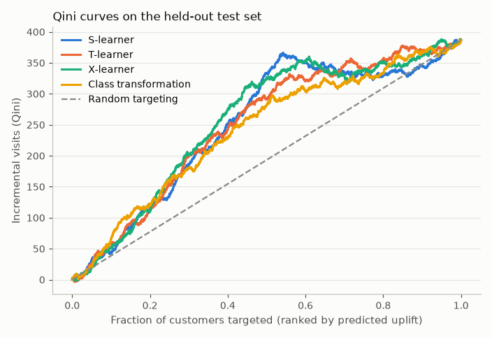
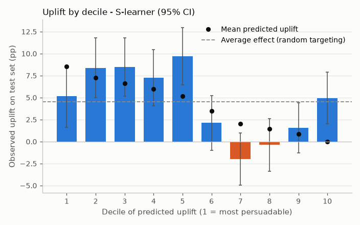
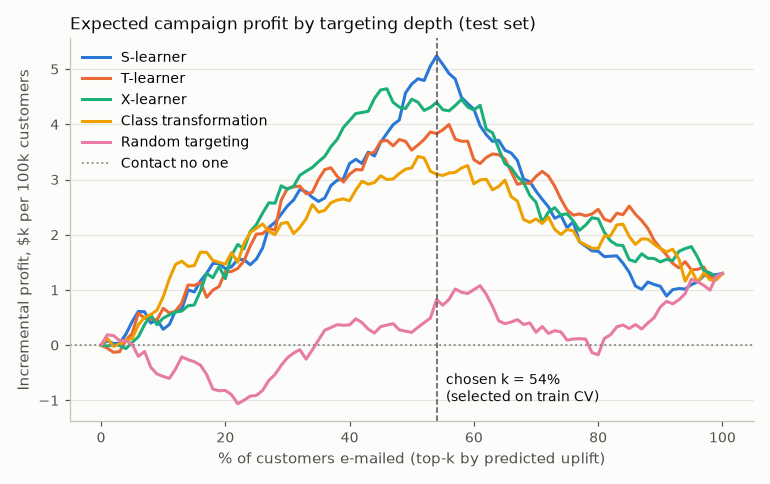
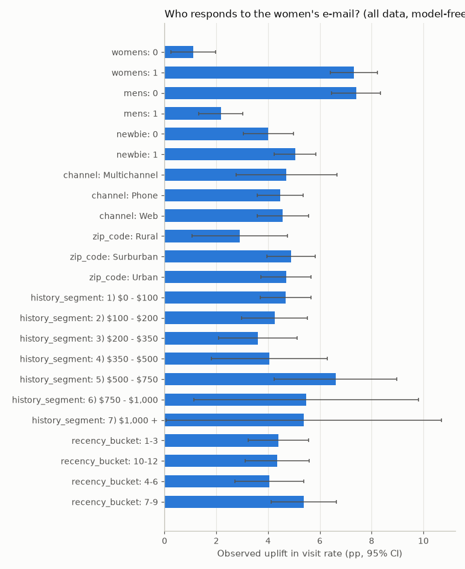

# Uplift Modelling for an E-mail Marketing Campaign

Causal targeting on a 64,000-customer randomised e-mail test: predict **who visits *because of* the e-mail**, not who visits, and turn that ranking into a profit-maximising send list.

## Business problem

A classic response model ranks customers by how likely they are to visit or buy. That spends budget on **sure things** (they would have come anyway) and **lost causes** (they won't come either way), and it can't see **sleeping dogs** (customers the message pushes away). What a marketing team needs is the *incremental* effect of the contact on each customer:

```
uplift(x) = P(visit | e-mail, x) - P(visit | no e-mail, x)
```

The decision this project supports: **for the next women's-merchandise e-mail, who should receive it, and how deep into the list should we go?** The answer depends on unit economics, so the model output is translated into expected profit under explicit, adjustable assumptions.

## Data

- **Kevin Hillstrom's MineThatData E-Mail Analytics and Data Mining Challenge (2008)**: [blog post](https://blog.minethatdata.com/2008/03/minethatdata-e-mail-analytics-and-data.html), [CSV](http://www.minethatdata.com/Kevin_Hillstrom_MineThatData_E-MailAnalytics_DataMiningChallenge_2008.03.20.csv).
- 64,000 customers who bought in the last 12 months, **randomised** into three equal arms: men's e-mail (21,307), women's e-mail (21,387), no e-mail (21,306). Outcomes over the following two weeks: `visit`, `conversion`, `spend`. Pre-treatment covariates: recency, purchase history ($), men's/women's merchandise flags, newbie flag, zip-code type, purchase channel.
- Released publicly by the author for analysis. It is not committed here. `scripts/download_data.py` fetches it (4 MB) and checks its SHA-256.
- For a large-scale extension, the [Criteo Uplift dataset](https://ailab.criteo.com/criteo-uplift-prediction-dataset/) (about 14M rows) has the same structure; the code is dataset-agnostic once you build `X`, `treatment` and `y`.

## Approach

1. **Experiment diagnostics.** Covariate balance across the three arms (standardised mean differences, ANOVA) and the average treatment effect (ATE) per arm and outcome with Welch 95% CIs.
2. **Business set-up.** Treatment = **women's e-mail** vs control (42,693 customers), outcome = **visit**. Conversion is too rare (under 1.3%) to rank individuals reliably at this sample size. The women's e-mail has the more heterogeneous effect, which is where targeting pays off.
3. **Split.** 60/40 train/test, stratified on treatment × outcome. All model and targeting-depth choices use **5-fold out-of-fold predictions on the training set**. The test set is scored once.
4. **Learners** (implemented in `learners.py` on top of LightGBM, any sklearn estimator works):
   - **S-learner**: one model with the treatment flag as a feature.
   - **T-learner**: separate models for treated and control.
   - **X-learner**: imputed individual effects, cross-fitted between arms (Künzel et al., 2019).
   - **Class transformation**: Jaskowski & Jaroszewicz (2012), re-weighted so it stays valid for unbalanced arms.
5. **Evaluation.** Qini curve and normalised Qini coefficient, uplift curve and normalised AUUC, uplift@k, observed uplift per decile, all compared with random targeting. Qini CIs come from a 200-sample bootstrap of the test set. The metric code is checked against `scikit-uplift` in the tests.
6. **Business simulation.** Expected incremental profit of e-mailing the top-k% by predicted uplift, compared with e-mailing everyone and with e-mailing no one. k is chosen on training CV and then evaluated on test. A sensitivity analysis varies the cost per e-mail.
7. **Interpretation.** Model-free uplift by segment, a depth-3 surrogate tree on the predicted uplift (readable segment rules, each checked against observed test uplift), and a profile of the top 20% vs bottom 20%.

## Results

All numbers come from `scripts/run_pipeline.py`. The full tables are in [`reports/results.md`](reports/results.md) and the narrative is in [`notebooks/uplift_analysis.ipynb`](notebooks/uplift_analysis.ipynb).

**The experiment is clean.** The largest |SMD| across all covariates and arms is 0.014, far below the usual 0.1 threshold. Both e-mails lift every outcome:

| Arm vs no e-mail | Visit rate (control → treated) | ATE visit [95% CI] | ATE conversion [95% CI] | ATE spend per customer [95% CI] |
|---|---|---|---|---|
| Women's e-mail | 10.6% → 15.1% | +4.5 pp [3.9, 5.2] | +0.31 pp [0.15, 0.47] | +$0.42 [0.17, 0.68] |
| Men's e-mail | 10.6% → 18.3% | +7.7 pp [7.0, 8.3] | +0.68 pp [0.50, 0.86] | +$0.77 [0.49, 1.05] |

**Model comparison** (women's e-mail, outcome = visit; test n = 17,078; test-set ATE = 4.5 pp):

| Model | CV Qini (train OOF) | Test Qini [95% bootstrap CI] | Test AUUC | Uplift in top 10% | Uplift in top 30% |
|---|---|---|---|---|---|
| **S-learner** (selected on CV) | **0.060** | 0.053 [0.029, 0.078] | 0.025 | 5.2 pp | 7.4 pp |
| T-learner | 0.053 | 0.055 [0.030, 0.083] | 0.025 | 6.7 pp | 7.8 pp |
| X-learner | 0.051 | 0.060 [0.038, 0.088] | 0.027 | 6.0 pp | 7.8 pp |
| Class transformation | 0.037 | 0.046 [0.024, 0.073] | 0.021 | 7.5 pp | 7.0 pp |
| Random targeting | -0.009 | -0.016 [-0.043, 0.005] | -0.007 | 1.7 pp | 3.7 pp |

The normalised Qini compares the area above the random line with the area for the perfect ranking. With binary outcomes the perfect ranking is unattainable, so small absolute values are normal. What matters is that every learner's CI excludes zero and that the curves sit well above random.

<p align="center"> </p>

**Business simulation.** These are assumptions, not measured facts; they are all in `CampaignEconomics`. Each incremental visit is worth **$2.50** of margin. The experiment shows about $9.4 of incremental spend per incremental visit, and $2.50 is roughly a 27% margin on that. Each e-mail costs **$0.10** fully loaded: delivery, creative, offer cost, and the fatigue or unsubscribe risk. A customer is therefore worth e-mailing only if their uplift is above 0.10 / 2.50 = **4 pp**. Results are scaled to 100,000 customers and evaluated on the test set:

| Strategy | Share e-mailed | Incremental visits | Cost | Incremental profit | ROI |
|---|---|---|---|---|---|
| Contact no one | 0% | 0 | $0 | $0 | – |
| Contact everyone (blanket) | 100% | 4,519 | $10,000 | $1,298 | 13% |
| Random 54% of the list | 54% | 2,490 | $5,400 | $826 | 15% |
| **S-learner, top 54% (k chosen on train CV)** | **54%** | **4,257** | **$5,400** | **$5,241** | **97%** |

At these economics, targeting keeps **94% of the incremental visits with 54% of the sends**. Profit gain vs the blanket campaign: **+$3,944 per 100k customers (95% bootstrap CI +$2,153 to +$5,503)**. The k chosen on CV turned out to match the best k in hindsight on the test set. The gain depends on the economics:

| Cost per e-mail | Break-even uplift | Chosen k | Profit, targeted | Profit, everyone |
|---|---|---|---|---|
| $0.05 | 2 pp | 76% | $6,033 | $6,298 (blanket slightly better) |
| $0.10 | 4 pp | 54% | $5,241 | $1,298 |
| $0.15 | 6 pp | 54% | $2,541 | -$3,702 |
| $0.20 | 8 pp | 4% | -$201 | -$8,702 |

<p align="center"></p>

**Who is persuadable?**

- Past **women's-merchandise buyers** are the persuadables: +7.3 pp uplift [6.4, 8.2] vs +1.1 pp [0.2, 2.0] for everyone else. Past men's-only buyers barely react.
- The surrogate tree splits first on `womens`, then on `newbie` and history/recency. All four `womens = 1` leaves have predicted uplift above the 4 pp break-even and observed test uplift of 6–9 pp. The `womens = 0` leaves are predicted at 0.4–2.2 pp.
- **Sleeping dogs are essentially absent for this e-mail.** Only 3% of customers get a negative predicted uplift, and the observed uplift in the bottom 20% is still positive (+3.3 pp [1.2, 5.3]). The reason to skip the low-uplift group is that they sit below break-even, not that the e-mail harms them.

<p align="center"></p>

**Key takeaways**

1. Uplift targeting turned a marginal blanket campaign (13% ROI) into a clearly profitable one (97% ROI) with half the volume, under explicit assumptions and validated out of sample.
2. The four meta-learners are statistically indistinguishable here (overlapping Qini CIs). Modelling uplift at all, plus a sound evaluation and decision layer, matters far more than which learner you pick.
3. The optimal list depth comes from the **economics** (break-even uplift = cost / value), not from the model. The same model gives very different send lists at $0.05 and at $0.20 per e-mail.

## How to run

```bash
cd projects/uplift-marketing-campaign
python -m venv .venv
.venv/Scripts/python -m pip install -r requirements-dev.txt   # Linux/macOS: .venv/bin/python
.venv/Scripts/python -m pip install -e .

.venv/Scripts/python scripts/download_data.py     # data/hillstrom.csv (4 MB, checksum-verified)
.venv/Scripts/python scripts/run_pipeline.py      # about 40 s: figures, reports/results.md, artifacts/summary.json
.venv/Scripts/python -m pytest -q                 # 17 tests, about 5 s, no network
.venv/Scripts/python -m jupyter nbconvert --to notebook --execute --inplace notebooks/uplift_analysis.ipynb
```

## Project structure

```
uplift-marketing-campaign/
├── README.md
├── pyproject.toml / requirements.txt / requirements-dev.txt
├── src/uplift_campaign/
│   ├── data.py        # download (SHA-256 check), features, binary treatment set-up
│   ├── stats.py       # covariate balance (SMD), ATE with CIs, segment effects
│   ├── learners.py    # S-, T-, X-learner, class transformation
│   ├── metrics.py     # Qini/uplift curves, Qini coefficient, AUUC, uplift by decile, bootstrap
│   ├── business.py    # campaign economics, profit curve, bootstrap profit gain
│   ├── modeling.py    # LightGBM config, out-of-fold CV, surrogate tree rules
│   ├── plots.py
│   └── pipeline.py    # end-to-end run
├── scripts/           # download_data.py, run_pipeline.py
├── notebooks/         # uplift_analysis.ipynb (executed)
├── tests/             # synthetic known-effect data: learners recover sign/ranking; metric sanity + sklift parity
└── reports/           # results.md + figures/
```

## Limitations & next steps

- **Economics are assumptions.** Value per visit and cost per e-mail drive the optimal depth. Swap in real margin and CRM cost figures, ideally per customer value tier.
- **Visit is a proxy.** Conversion and spend uplift are the real goal but are too sparse here. Options: a larger sample (e.g. Criteo-scale data), or modelling spend uplift with a continuous-outcome learner (T-/X-learner regressors already support it).
- **Single split, single dataset.** The Qini CIs show substantial noise. Repeated splits and hyperparameter tuning on the Qini metric would tighten model choice, and the S-learner is known to shrink effects towards zero (seen in the synthetic tests).
- **Two treatments.** The men's e-mail has a larger average effect. A multi-treatment uplift model (choose *which* e-mail, if any, per customer) is the natural next step.
- **Validation in production.** Keep a random holdout in every send, so uplift can be re-measured and the model refreshed as customer behaviour drifts.
- Not tried: `causalml` uplift random forests. The meta-learners were implemented directly to keep dependencies light and Windows-friendly.
